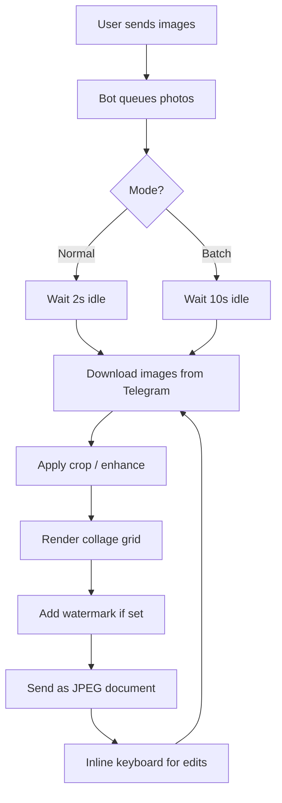

# 📸 PGXC Collage Bot
### 🤖 Multi-Account Screenshot Collage Engine for Telegram


---

## ⚠️ Requirements
> 🐍 Python 3.10+  
> 🤖 A Telegram Bot Token from [@BotFather](https://t.me/BotFather)  
> 🆔 Your Telegram User ID from [@userinfobot](https://t.me/userinfobot)

---

## ✨ Features

🚀 **Auto-Build Engine** — Builds collages automatically after 2 seconds of inactivity  
⚡ **Batch Mode** — Queue all images first, auto-builds after 10 seconds of silence  
🎨 **4 Smart Layouts** — Auto, Horizontal, Wide, Vertical  
🖼 **Inline Editing** — Rebuild with different settings after delivery, no re-upload needed  
💧 **Watermark** — Add a custom text label to any collage  
📱 **Crop UI** — Strips phone status bars and navigation bars automatically  
✨ **Enhance Mode** — Sharpness, contrast and brightness boost  
📦 **Up to 20 images** per collage, delivered as full-quality JPEG  
🔐 **Admin Panel** — Ban/unban users, broadcast messages, live stats  

---

## 🧠 How It Works



---

## 📦 Installation

```bash
git clone https://github.com/your-username/pgxc-collage-bot.git
cd pgxc-collage-bot
pip install -r requirements.txt
```

---

## ⚙️ Configuration

Copy the env template and fill in your values:

```bash
cp _env .env
```

Edit `.env`:

```env
BOT_TOKEN=your_bot_token_from_botfather
ADMIN_IDS=your_telegram_user_id
```

> For multiple admins: `ADMIN_IDS=111111,222222`

---

## ▶️ Run

```bash
python bot.py
```

---

## 🤖 Commands

> 💡 **No prefix needed** — just send images and the bot does the rest

### 🖼 Collage Controls

| Command | Description |
|---|---|
| `/batch` | Queue mode — auto-builds after 10 s of inactivity |
| `/layout` | Choose collage grid style |
| `/quality <1–95>` | Set JPEG output quality |
| `/watermark <text>` | Add or remove a watermark label |
| `/cropui` | Toggle removal of phone status/nav bars |
| `/enhance` | Toggle sharpness and colour boost |

### 📋 Queue Management

| Command | Description |
|---|---|
| `/undo` | Remove last queued image |
| `/remove <n>` | Remove image at position n |
| `/count` | How many images are queued |
| `/status` | Show all current settings |
| `/clear` | Reset queue and settings |

### 🔐 Admin Only

| Command | Description |
|---|---|
| `/adminhelp` | Show full admin reference |
| `/ban <id>` | Ban a user (or reply to message) |
| `/unban <id>` | Unban a user |
| `/banlist` | List all banned users |
| `/broadcast <msg>` | Message all active sessions |
| `/setwelcome <text>` | Set custom welcome message |
| `/resetwelcome` | Restore default welcome message |
| `/stats` | Sessions, queues, and ban counts |

---

## 🎨 Layout Options

| Layout | Preview | Description |
|---|---|---|
| **Auto** | `▦` | Best-fit grid chosen automatically |
| **Horizontal** | `▬` | Single row |
| **Wide** | `▬▬` | Two rows |
| **Vertical** | `▮` | Single column |

---

## 📁 Project Structure

```
PGXCCollageBot/
├── bot.py               # Main bot — handlers, sessions, commands
├── collage.py           # Collage rendering engine (Pillow)
├── requirements.txt     # Python dependencies
├── _env                 # Config template — copy to .env
├── .gitignore           # Keeps secrets out of git
├── README.md            # This file
│
# Created at runtime (never committed):
├── .env                 # Your secrets
└── bot_state.json       # Banned users + custom welcome message
```

---

## 📊 Real-Time Stats (via `/stats`)

- 🧑‍💻 Total active sessions
- 📬 Queues currently building
- 🚫 Banned user count

---

## 🔐 Security

> ❗ **Never upload:**
> - `.env`
> - `bot_state.json`

✔ Both are already covered by `.gitignore`  
✔ `_env` is a safe placeholder template — no real credentials  
✔ Rotate your bot token immediately if it was ever exposed  

---

## 🛠 Dependencies

| Package | Purpose |
|---|---|
| `python-telegram-bot` | Telegram Bot API wrapper |
| `Pillow` | Image processing and collage rendering |
| `python-dotenv` | Load secrets from `.env` |
| `httpx` | HTTP client for Telegram API |

```bash
pip install -r requirements.txt
```

---

## 🔥 Future Plans

- 🌐 Web dashboard for managing sessions
- 📊 Per-user collage analytics
- 🗄 Database backend for persistent sessions
- 🖼 PNG and WebP output support
- ⚙️ Custom grid templates

---

## 👨‍💻 Author

Built by **PGXC** ⚡ Collage automation for power users

---

## ⭐ Support

If you find this useful:
- ⭐ Star the repo
- 🍴 Fork it
- 🚀 Improve it

---

## 📜 License

MIT License — do whatever you want, just don't blame me if it breaks.

---

> ⚡ *Send. Queue. Collage. Done.*
